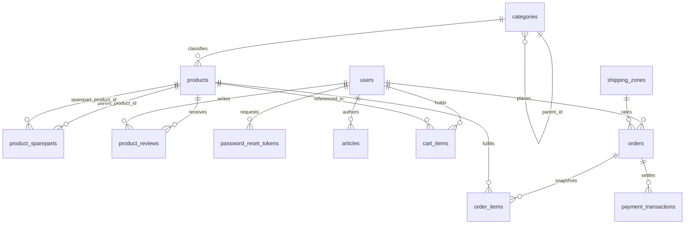
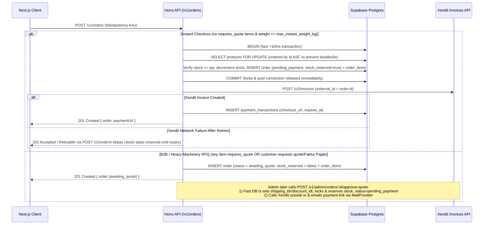

# Tsuzumi Japan Backend — Optimized Architecture Blueprint (`v2.1`)

> **Companion document:** [tsuzumi-network-audit.md](./tsuzumi-network-audit.md) (captured traffic & legacy payload audit from `https://tsuzumijapan.com/`).
>
> **Target Consumer:** New **Next.js (App Router)** storefront & admin panel built alongside **Bun + Hono (`@hono/zod-openapi`) + Drizzle ORM + Supabase PostgreSQL & Storage**.
>
> **Status:** Locked architectural specification (`v2.1`) — static showcase visuals moved to Next.js; backend strictly owns dynamic, SEO, and transactional data.

---

## 1. Frontend vs. Backend Responsibility Boundary

Static showcase assets that rarely change belong in **Next.js (`public/` + `<Image priority />` + static TS data)** — avoiding an API waterfall before Largest Contentful Paint (LCP) and deleting unnecessary tables and CRUD routes:

| Feature                                  | Lives In                                                | Why                                                                                                                          |
| ---------------------------------------- | ------------------------------------------------------- | ---------------------------------------------------------------------------------------------------------------------------- |
| **Hero Banners & Promo Strips**          | **Next.js (`public/`)**                                 | Zero API waterfall before LCP image preload; automatic AVIF/WebP + blur placeholders                                         |
| **"Satisfied Clients" Logo Grid**        | **Next.js static data**                                 | Static logo showcase; zero reason for DB queries or admin CRUD                                                               |
| **"Powered By" Brand Cards & Logos**     | **Next.js static data** (+ `products.brand_slug` in DB) | ~6 fixed engine makers (Tsuzumi, Perkins, Yanmar, Cummins, Isuzu, FAW-VW); filterable on `products` without a `brands` table |
| **Categories, Products, Specs, Compare** | **Backend (`project-1`)**                               | Live stock, IDR pricing, dynamic technical specs, SKU search, spare-part graph                                               |
| **SEO Articles & Sitemap Feed**          | **Backend (`project-1`) + Next.js ISR**                 | Non-dev SEO writers publish without Git deploys; embeds live `related_product_ids` cards; triggers Next.js `revalidateTag`   |
| **Auth, Reviews, Cart, Orders, Xendit**  | **Backend (`project-1`)**                               | Security-critical state, IDOR checks, stock locking, and payment webhooks                                                    |

---

## 2. Key Architectural Optimizations Over `v1` (16 Tables → 11 Tables)

| Area                      | Initial Draft (`v1`)                                                                 | Optimized `v2.1` Design                                                                                                                     | Engineering Payoff                                                                                             |
| ------------------------- | ------------------------------------------------------------------------------------ | ------------------------------------------------------------------------------------------------------------------------------------------- | -------------------------------------------------------------------------------------------------------------- |
| **Static Showcase**       | `banners`, `clients`, and `brands` DB tables + CRUD                                  | Moved static visuals to Next.js; indexed `brand_slug` column on `products`                                                                  | Cuts **3 tables** & ~12 CRUD endpoints; improves homepage LCP                                                  |
| **Taxonomy & Specs**      | 4 tables (`categories`, `sub_categories`, `spec_columns`, `product_spec_values` EAV) | **1 self-referencing `categories` (`parent_id`)** + `spec_schema` (`jsonb`) + `products.specs` (`jsonb` GIN)                                | Cuts **3 tables**, prevents category/subcategory FK drift, 0-join `/compare` & detail, numeric range filters   |
| **Product Media & Cards** | `product_images` + `product_videos` tables + runtime `AVG(rating)`                   | Bounded **`products.media` (`jsonb`, ≤20)** + denormalized `primary_image_url`, `rating_avg`, `review_count`                                | Cuts **2 tables**; **0-join** `GET /v1/products` cards & **1-row** `GET /v1/products/:slug` detail             |
| **Cart Storage**          | 1:1 `carts` header table + `cart_items`                                              | Direct **`cart_items(user_id, product_id)`** unique composite key                                                                           | Cuts **1 wrapper table** & 1 join on every cart read/upsert                                                    |
| **SEO & Rich Text**       | Raw HTML + custom regex sanitizer (`sanitize.ts`)                                    | **Markdown (`description_md`, `content_md`)** + SEO meta columns + `articles.related_product_ids` + Next.js ISR webhook + `/v1/seo/sitemap` | Zero stored-XSS risk, instant edge-cached HTML via `revalidateTag`, internal PageRank from articles → products |
| **Checkout Concurrency**  | Xendit HTTP call _inside_ `SELECT ... FOR UPDATE` DB transaction                     | **2-Step Reservation** (fast `<10ms` DB lock & commit → Xendit API call outside lock with `external_id = order.id`)                         | Protects `DB_POOL_MAX=5` and Supavisor from pool starvation during slow payment gateway calls                  |
| **B2B + Retail Commerce** | Instant Xendit checkout only, undefined shipping calculation                         | **Hybrid Instant + RFQ (`awaiting_quote`)** state machine + pluggable `ShippingCalculator` (`shipping_zones` now → Biteship later)          | Handles both `Rp 650k` retail tools and `Rp 177.5M+` heavy industrial gensets in one `orders` model            |
| **Customer Auth**         | Unverified phone-or-email login                                                      | **Email+Password + Google Sign-In (JWKS)**; `phone` as profile/shipping/WhatsApp contact; Email reset via `MailProvider`                    | Prevents unverified phone-squatting account takeovers without day-1 SMS OTP cost                               |

---

## 3. Existing Foundation vs. New Deliverables

### Reuse Directly (`project-1`)

- **HTTP & Lifecycle:** `src/app.ts`, `src/index.ts`, `src/v1/routes.ts` (`/health`, `/ready`, `/v1/openapi.json`, graceful `SIGTERM`).
- **Database Pool:** `src/db/client.ts` (`prepare: false` for Supavisor `:6543`, automatic TLS on `*.supabase.com`).
- **Core Lib & Middlewares:** `id.ts` (UUIDv7), `password.ts` (Argon2id), `crypto.ts` (SHA-256), `jwt.ts` (pinned `HS256`), `pagination.ts` (cursor pagination), `errors.ts`, `logger.ts` (Pino), `request-id`, `rate-limit`, `requireAuth`, `error-handler`.
- **Auth & Users:** `src/modules/auth` (Argon2id + refresh token family rotation) and `src/modules/users` (`role: 'user' | 'admin'`, IDOR checks).

### New Components to Build

1. **Middlewares (`src/middlewares/`):**
   - `authorize.ts` — `requireAdmin` role guard (`403 ForbiddenError`), backed by service-layer authorization checks.
   - `cache-control.ts` — `Cache-Control` (`public, max-age=..., s-maxage=..., stale-while-revalidate=...`) + weak `ETag` (`304 Not Modified`) helper.
2. **Adapters (`src/lib/`):**
   - `slug.ts` — Deterministic URL slug normalization + collision handling.
   - `revalidate.ts` — Non-blocking Next.js ISR webhook notifier (`POST NEXTJS_REVALIDATE_URL` with shared secret + tag names when categories, products, or articles change).
   - `storage.ts` — Supabase Storage presigned upload URL adapter (zero file buffering in API memory).
   - `google-oauth.ts` — Google ID token verifier via Google's public JWKS (`iss`, `aud`, `exp`, `email_verified`).
   - `mailer.ts` — `MailProvider` interface (Resend HTTP adapter in production, structured log/memory stub in dev & test).
   - `shipping.ts` — `ShippingCalculator` interface backed initially by `shipping_zones` per-kg DB rules (swappable to Biteship/RajaOngkir).
   - `xendit.ts` — Xendit Invoice v2 client (timeouts, bounded retries, deterministic `external_id`) + constant-time `x-callback-token` verifier.
3. **Six Focused Feature Modules (`src/modules/`):**
   - `catalog` — Self-referencing categories, inherited `spec_schema` templates, and `/v1/seo/sitemap` index feed.
   - `articles` — SEO blog articles (`content_md`, `meta_title`, `meta_description`, `related_product_ids`) with live product card hydration.
   - `media` — Presigned Supabase Storage upload URL issuance (`POST /v1/admin/media/upload-url`).
   - `products` — Products (`brand_slug`, JSONB specs & media), SKU/Indonesian search, spare-part links, recommendations, and batch `/v1/products/compare`.
   - `reviews` — Verified-purchase customer product reviews + transactional product rating rollups.
   - `commerce` — `cart_items`, `shipping_zones`, hybrid instant/RFQ `orders`, and Xendit webhooks.

---

## 4. Database Schema Specification (`src/db/schema/`)

> **Non-Negotiable Postgres & Supabase Rules:**
>
> - Every table in `public` **must** call `.enableRLS()` so Supabase's auto-exposed Data API denies `anon`/`authenticated` access by default.
> - Primary keys use application-generated **UUIDv7** (`generateId()`).
> - Monetary values use **`bigint` (`mode: 'number'`)** in whole IDR (`CHECK (amount >= 0)`). Dimensions/weights use **`numeric(10, 2)`**. Ratings use **`numeric(3, 2)`**.
> - Every foreign key column has an explicit B-tree index. Soft-deletable slugs use partial unique indexes (`WHERE deleted_at IS NULL`).
> - Enable `pg_trgm` extension (`CREATE EXTENSION IF NOT EXISTS pg_trgm;`) for fuzzy SKU and product name search.

### Entity Relationship Diagram (11 New Tables + Extended `users`)



### 4.1 Auth & User Extensions (`users.ts`, `password-reset-tokens.ts`)

| Table / Column          | Type                                                                                                                                                                                                            | Constraints & Indexes                                                                            |
| ----------------------- | --------------------------------------------------------------------------------------------------------------------------------------------------------------------------------------------------------------- | ------------------------------------------------------------------------------------------------ |
| `users.phone`           | `varchar(24)`                                                                                                                                                                                                   | Nullable profile/shipping/WhatsApp contact (E.164 normalized; **not** a login identifier)        |
| `users.google_sub`      | `varchar(128)`                                                                                                                                                                                                  | Nullable; partial unique index `WHERE google_sub IS NOT NULL`                                    |
| `users.password_hash`   | `text`                                                                                                                                                                                                          | Nullable for Google-only accounts; `CHECK (password_hash IS NOT NULL OR google_sub IS NOT NULL)` |
| `password_reset_tokens` | `id` (`uuid` PK), `user_id` (`uuid` FK → `users.id` `ON DELETE CASCADE`), `token_hash` (`varchar(64)` `UNIQUE`), `expires_at` (`timestamptz`), `used_at` (`timestamptz` nullable), `created_at` (`timestamptz`) | `.enableRLS()`; SHA-256 hex digest only; index `(user_id, expires_at)`                           |

### 4.2 Catalog Taxonomy & Typed Spec Schemas (`categories.ts`)

| Column                                   | Type                                                      | Constraints & Notes                                                                                                                                                                                             |
| ---------------------------------------- | --------------------------------------------------------- | --------------------------------------------------------------------------------------------------------------------------------------------------------------------------------------------------------------- |
| `id`                                     | `uuid` PK                                                 | UUIDv7                                                                                                                                                                                                          |
| `parent_id`                              | `uuid` nullable FK → `categories.id` `ON DELETE RESTRICT` | `NULL` = root category (e.g. _Genset Silent_); non-null = subcategory (e.g. _Engine Perkins_). Max depth `2` enforced in service                                                                                |
| `name`                                   | `varchar(120)` `NOT NULL`                                 | Display name                                                                                                                                                                                                    |
| `slug`                                   | `varchar(140)` `NOT NULL`                                 | Partial unique index `(slug) WHERE deleted_at IS NULL`                                                                                                                                                          |
| `description`                            | `text` nullable                                           | Category intro copy (supports SEO category landing pages)                                                                                                                                                       |
| `meta_title`                             | `varchar(160)` nullable                                   | Custom `<title>` override for Next.js `generateMetadata`                                                                                                                                                        |
| `meta_description`                       | `varchar(320)` nullable                                   | Custom meta description override                                                                                                                                                                                |
| `image_url`                              | `text` nullable                                           | Category card thumbnail                                                                                                                                                                                         |
| `banner_image_url`                       | `text` nullable                                           | Optional category header image                                                                                                                                                                                  |
| `spec_schema`                            | `jsonb` `NOT NULL DEFAULT '[]'`                           | Zod-validated array of `SpecFieldDef`: `{ key: string, label: string, unit?: string, type: 'number' \| 'text' \| 'boolean', sortOrder: number }`. Subcategories inherit parent `spec_schema` + append overrides |
| `sort_order`                             | `integer` `NOT NULL DEFAULT 0`                            | Manual display ordering                                                                                                                                                                                         |
| `is_active`                              | `boolean` `NOT NULL DEFAULT true`                         | Storefront visibility                                                                                                                                                                                           |
| `created_at`, `updated_at`, `deleted_at` | `timestamptz`                                             | `.enableRLS()`; indexes on `(parent_id, sort_order, id)` and `(sort_order, id) WHERE deleted_at IS NULL`                                                                                                        |

### 4.3 SEO Articles (`articles.ts`)

| Column                                   | Type                                                 | Constraints & Notes                                                                         |
| ---------------------------------------- | ---------------------------------------------------- | ------------------------------------------------------------------------------------------- |
| `id`                                     | `uuid` PK                                            | UUIDv7                                                                                      |
| `author_id`                              | `uuid` nullable FK → `users.id` `ON DELETE SET NULL` | Indexed                                                                                     |
| `title`                                  | `varchar(255)` `NOT NULL`                            | `<h1>` article headline                                                                     |
| `slug`                                   | `varchar(280)` `NOT NULL`                            | Partial unique `(slug) WHERE deleted_at IS NULL`                                            |
| `excerpt`                                | `text` nullable                                      | Summary card blurb                                                                          |
| `content_md`                             | `text` `NOT NULL`                                    | Markdown body rendered via React components in Next.js                                      |
| `cover_image_url`                        | `text` nullable                                      | OpenGraph & article hero image (stored in Supabase Storage)                                 |
| `meta_title`                             | `varchar(160)` nullable                              | Optional SEO `<title>` override (falls back to `title`)                                     |
| `meta_description`                       | `varchar(320)` nullable                              | Optional SEO meta description override (falls back to `excerpt`)                            |
| `tags`                                   | `text[]` `NOT NULL DEFAULT '{}'`                     | GIN-indexed topic tags for related-article matching                                         |
| `related_product_ids`                    | `uuid[]` `NOT NULL DEFAULT '{}'`                     | Bounded (≤12) product UUIDs hydrated as live product cards inside the article               |
| `is_published`                           | `boolean` `NOT NULL DEFAULT false`                   | Draft vs live                                                                               |
| `published_at`                           | `timestamptz` nullable                               | Used for `Article` JSON-LD `datePublished` & cursor ordering                                |
| `created_at`, `updated_at`, `deleted_at` | `timestamptz`                                        | `.enableRLS()`; index `(is_published, published_at DESC, id DESC) WHERE deleted_at IS NULL` |

### 4.4 Products, JSONB Specs/Media & Spare Parts (`products.ts`)

| Table                | Columns                                                                                                                                                                                                                                                                                                                                                                                                                                                                                                                                                                                                                                                                                                                                                                                                                                                                                                                                                                                                                                                                                                                                                                                                                                          | Indexes & Constraints                                                                                                                                                                                                                                                                                                                                                                                                                                                                    |
| -------------------- | ------------------------------------------------------------------------------------------------------------------------------------------------------------------------------------------------------------------------------------------------------------------------------------------------------------------------------------------------------------------------------------------------------------------------------------------------------------------------------------------------------------------------------------------------------------------------------------------------------------------------------------------------------------------------------------------------------------------------------------------------------------------------------------------------------------------------------------------------------------------------------------------------------------------------------------------------------------------------------------------------------------------------------------------------------------------------------------------------------------------------------------------------------------------------------------------------------------------------------------------------ | ---------------------------------------------------------------------------------------------------------------------------------------------------------------------------------------------------------------------------------------------------------------------------------------------------------------------------------------------------------------------------------------------------------------------------------------------------------------------------------------- |
| `products`           | `id` (`uuid` PK), `category_id` (`uuid` FK → `categories.id` `ON DELETE RESTRICT`), `brand_slug` (`varchar(64)` nullable, e.g. `'perkins'`, `'cummins'`, `'tsuzumi'`), `name` (`varchar(255)` `NOT NULL`), `slug` (`varchar(280)` `NOT NULL`), `sku` (`varchar(80)` nullable), `product_type` (`varchar(24)` `DEFAULT 'equipment'`: `'equipment' \| 'sparepart'`), `description_md` (`text`), `meta_title` (`varchar(160)`), `meta_description` (`varchar(320)`), `price_idr` (`bigint` `NOT NULL`), `requires_quote` (`boolean` `NOT NULL DEFAULT false`), `stock` (`integer` `NOT NULL DEFAULT 0`), `is_featured` (`boolean` `NOT NULL DEFAULT false`), `is_active` (`boolean` `NOT NULL DEFAULT true`), `primary_image_url` (`text` nullable), `media` (`jsonb` `NOT NULL DEFAULT '[]'`), `specs` (`jsonb` `NOT NULL DEFAULT '{}'`), `length_cm` (`numeric(10,2)`), `width_cm` (`numeric(10,2)`), `height_cm` (`numeric(10,2)`), `weight_kg` (`numeric(10,2)`), `rating_avg` (`numeric(3,2)` `NOT NULL DEFAULT 0`), `review_count` (`integer` `NOT NULL DEFAULT 0`), `search_vector` (`tsvector` generated `STORED` using `'simple'` dictionary over `name`, `sku`, `brand_slug`, `description_md`), `created_at`, `updated_at`, `deleted_at` | `.enableRLS()`; `CHECK (price_idr >= 0 AND stock >= 0 AND review_count >= 0)`; partial unique `(slug)` & `(sku)` `WHERE deleted_at IS NULL`; B-tree indexes on `(category_id, created_at DESC, id DESC)`, `(brand_slug, created_at DESC, id DESC) WHERE deleted_at IS NULL`, `(is_featured, created_at DESC, id DESC) WHERE is_active = true AND deleted_at IS NULL`; GIN `jsonb_path_ops` on `specs`; GIN on `search_vector`; `pg_trgm` GIN on `(name \|\| ' ' \|\| coalesce(sku, ''))` |
| `product_spareparts` | `parent_product_id` (`uuid` FK → `products.id` `ON DELETE CASCADE`), `sparepart_product_id` (`uuid` FK → `products.id` `ON DELETE CASCADE`), `note` (`varchar(160)` nullable), `created_at`                                                                                                                                                                                                                                                                                                                                                                                                                                                                                                                                                                                                                                                                                                                                                                                                                                                                                                                                                                                                                                                      | `.enableRLS()`; composite PK `(parent_product_id, sparepart_product_id)`; index `sparepart_product_id`; `CHECK (parent_product_id <> sparepart_product_id)`                                                                                                                                                                                                                                                                                                                              |

**JSONB Shapes Validated by Zod at Write Time:**

- `products.media`: `Array<{ id: uuid, type: 'image' | 'video', url: string, altText?: string }>` (max `20`; `primary_image_url` auto-synced to first `'image'`).
- `products.specs`: `Record<string, string | number | boolean>` validated against effective `category.spec_schema` (root + subcategory merged).

### 4.5 Product Reviews (`product-reviews.ts`)

| Table             | Columns                                                                                                                                                                                                                                                                                                                                  | Indexes & Constraints                                                                                                                                                                                                                   |
| ----------------- | ---------------------------------------------------------------------------------------------------------------------------------------------------------------------------------------------------------------------------------------------------------------------------------------------------------------------------------------- | --------------------------------------------------------------------------------------------------------------------------------------------------------------------------------------------------------------------------------------- |
| `product_reviews` | `id` (`uuid` PK), `product_id` (`uuid` FK → `products.id` `ON DELETE CASCADE`), `user_id` (`uuid` FK → `users.id` `ON DELETE RESTRICT`), `order_id` (`uuid` FK → `orders.id` `ON DELETE RESTRICT`), `rating` (`smallint` `NOT NULL`), `comment` (`text`), `is_published` (`boolean` `NOT NULL DEFAULT true`), `created_at`, `updated_at` | `.enableRLS()`; `CHECK (rating BETWEEN 1 AND 5)`; unique `(order_id, product_id)`; indexes on `(product_id, is_published, created_at DESC, id DESC)` and `user_id`. Recalculates `products.rating_avg` & `review_count` transactionally |

### 4.6 Commerce, Shipping & Hybrid Checkout (`commerce.ts`)

| Table                  | Columns                                                                                                                                                                                                                                                                                                                                                                                                                                                                                                                                                                                                                                                                                                                                                                                                                                                                                                                                                                                                                | Indexes & Constraints                                                                                                                                               |
| ---------------------- | ---------------------------------------------------------------------------------------------------------------------------------------------------------------------------------------------------------------------------------------------------------------------------------------------------------------------------------------------------------------------------------------------------------------------------------------------------------------------------------------------------------------------------------------------------------------------------------------------------------------------------------------------------------------------------------------------------------------------------------------------------------------------------------------------------------------------------------------------------------------------------------------------------------------------------------------------------------------------------------------------------------------------- | ------------------------------------------------------------------------------------------------------------------------------------------------------------------- |
| `cart_items`           | `id` (`uuid` PK), `user_id` (`uuid` FK → `users.id` `ON DELETE CASCADE`), `product_id` (`uuid` FK → `products.id` `ON DELETE CASCADE`), `quantity` (`integer` `NOT NULL`), `created_at`, `updated_at`                                                                                                                                                                                                                                                                                                                                                                                                                                                                                                                                                                                                                                                                                                                                                                                                                  | `.enableRLS()`; `CHECK (quantity > 0)`; unique `(user_id, product_id)`; index `product_id`                                                                          |
| `shipping_zones`       | `id` (`uuid` PK), `name` (`varchar(120)` e.g. `"Jabodetabek"`), `province_code` (`varchar(16)` `UNIQUE`), `base_rate_idr` (`bigint` `NOT NULL`), `per_kg_rate_idr` (`bigint` `NOT NULL`), `max_instant_weight_kg` (`numeric(10,2)` `DEFAULT 100.00`), `is_active` (`boolean` `DEFAULT true`), `created_at`, `updated_at`                                                                                                                                                                                                                                                                                                                                                                                                                                                                                                                                                                                                                                                                                               | `.enableRLS()`; `CHECK (base_rate_idr >= 0 AND per_kg_rate_idr >= 0)`. Orders exceeding `max_instant_weight_kg` automatically route to `awaiting_quote`             |
| `orders`               | `id` (`uuid` PK), `order_number` (`varchar(40)` `UNIQUE`), `user_id` (`uuid` FK → `users.id` `ON DELETE RESTRICT`), `checkout_mode` (`varchar(20)`: `'instant' \| 'quote'`), `status` (`varchar(32)`: `'awaiting_quote' \| 'pending_payment' \| 'paid' \| 'processing' \| 'shipped' \| 'completed' \| 'cancelled' \| 'expired'`), `subtotal_idr` (`bigint` `NOT NULL`), `shipping_idr` (`bigint` `NOT NULL DEFAULT 0`), `discount_idr` (`bigint` `NOT NULL DEFAULT 0`), `total_idr` (`bigint` `NOT NULL`), `total_weight_kg` (`numeric(10,2)` `NOT NULL`), `shipping_zone_id` (`uuid` nullable FK → `shipping_zones.id`), `shipping_recipient` (`varchar(160)` `NOT NULL`), `shipping_phone` (`varchar(24)` `NOT NULL`), `shipping_address` (`text` `NOT NULL`), `tax_npwp` (`varchar(32)` nullable for B2B _Faktur Pajak_), `customer_notes` (`text`), `admin_quote_notes` (`text`), `stock_reserved` (`boolean` `NOT NULL DEFAULT false`), `idempotency_key` (`varchar(128)` `NOT NULL`), `created_at`, `updated_at` | `.enableRLS()`; unique `(user_id, idempotency_key)`; indexes on `(user_id, created_at DESC, id DESC)`, `(status, created_at DESC, id DESC)`, and `shipping_zone_id` |
| `order_items`          | `id` (`uuid` PK), `order_id` (`uuid` FK → `orders.id` `ON DELETE CASCADE`), `product_id` (`uuid` FK → `products.id` `ON DELETE RESTRICT`), `product_name_snapshot` (`varchar(255)` `NOT NULL`), `sku_snapshot` (`varchar(80)`), `unit_price_idr` (`bigint` `NOT NULL`), `weight_kg_snapshot` (`numeric(10,2)` `NOT NULL`), `quantity` (`integer` `NOT NULL`), `line_total_idr` (`bigint` `NOT NULL`), `created_at`                                                                                                                                                                                                                                                                                                                                                                                                                                                                                                                                                                                                     | `.enableRLS()`; indexes on `order_id` and `product_id`                                                                                                              |
| `payment_transactions` | `id` (`uuid` PK), `order_id` (`uuid` FK → `orders.id` `ON DELETE RESTRICT`), `provider` (`varchar(32)` `DEFAULT 'xendit'`), `external_invoice_id` (`varchar(128)` `UNIQUE`), `idempotency_reference` (`varchar(128)` `UNIQUE`), `checkout_url` (`text` `NOT NULL`), `amount_idr` (`bigint` `NOT NULL`), `status` (`varchar(32)`: `'pending' \| 'paid' \| 'expired' \| 'failed'`), `raw_webhook_payload` (`jsonb`), `paid_at` (`timestamptz`), `expires_at` (`timestamptz` `NOT NULL`), `created_at`, `updated_at`                                                                                                                                                                                                                                                                                                                                                                                                                                                                                                      | `.enableRLS()`; indexes on `order_id` and `(status, expires_at)`                                                                                                    |

---

## 5. Concurrency-Safe Checkout & RFQ Flow

**Critical Rule:** Never call Xendit (or any external HTTP API) inside an open PostgreSQL transaction.



---

## 6. Target `/v1` API Surface

All endpoints mount under `src/v1/routes.ts`, enforce `.strict()` Zod schemas, and return `{ data }` / `{ data, meta }` / `{ error }`.

### 6.1 Public Storefront & SEO Endpoints (Next.js ISR Ready)

| Method & Path                      | Query / Params                                                                                                               | Next.js Cache Tag & `Cache-Control`                                             | Purpose                                                                                                      |
| ---------------------------------- | ---------------------------------------------------------------------------------------------------------------------------- | ------------------------------------------------------------------------------- | ------------------------------------------------------------------------------------------------------------ |
| `GET /v1/categories`               | `tree?: boolean`                                                                                                             | Tag `categories` · `public, max-age=300, s-maxage=3600`                         | Full category/subcategory hierarchy                                                                          |
| `GET /v1/categories/:slug`         | Path `slug`                                                                                                                  | Tag `category:<slug>` · `public, max-age=300, s-maxage=3600`                    | Category detail, subcategories, SEO meta, and merged `specSchema`                                            |
| `GET /v1/products`                 | `cursor?`, `limit?`, `categorySlug?`, `brandSlug?`, `isFeatured?`, `type?`, `requiresQuote?`, `minPrice?`, `maxPrice?`, `q?` | Tag `products` · `public, max-age=30, s-maxage=120, stale-while-revalidate=300` | Zero-join cursor-paginated product cards + `'simple'` FTS & `pg_trgm` SKU search                             |
| `GET /v1/products/compare`         | `ids` (2..4 UUIDs) or `slugs` (2..4 slugs)                                                                                   | `public, max-age=60, s-maxage=300`                                              | Single query returning aligned `specSchema` rows + product specs                                             |
| `GET /v1/products/recommendations` | `categoryId?`, `excludeProductId?`, `limit?` (≤12)                                                                           | `public, max-age=120, s-maxage=600`                                             | Indexed same-category featured/recent items (no `ORDER BY RANDOM()`)                                         |
| `GET /v1/products/:slug`           | Path `slug`, `include?: 'spareparts,related'`                                                                                | Tag `product:<slug>` · `public, max-age=60, s-maxage=300`                       | Single-row product detail (`media[]`, `specs`, SEO meta, rating summary) + optional `spareparts` & `related` |
| `GET /v1/products/:id/spareparts`  | `cursor?`, `limit?`                                                                                                          | `public, max-age=120, s-maxage=600`                                             | Paginated compatible spare parts                                                                             |
| `GET /v1/products/:id/reviews`     | `cursor?`, `limit?`                                                                                                          | `public, max-age=60, s-maxage=120`                                              | Cursor-paginated published verified reviews                                                                  |
| `GET /v1/articles`                 | `cursor?`, `limit?`, `tag?`                                                                                                  | Tag `articles` · `public, max-age=300, s-maxage=3600`                           | Cursor-paginated published SEO articles                                                                      |
| `GET /v1/articles/:slug`           | Path `slug`, `includeRelated?: boolean`                                                                                      | Tag `article:<slug>` · `public, max-age=300, s-maxage=3600`                     | Markdown article + SEO meta + hydrated live `relatedProducts[]` cards + related articles                     |
| `GET /v1/seo/sitemap`              | —                                                                                                                            | Tag `sitemap` · `public, max-age=300, s-maxage=3600`                            | Lightweight `{ categories, products, articles }` `{ slug, updatedAt }` index for Next.js `app/sitemap.ts`    |
| `GET /v1/shipping-zones`           | —                                                                                                                            | `public, max-age=300, s-maxage=3600`                                            | Active shipping provinces/zones for checkout estimation                                                      |

### 6.2 Authenticated Customer Endpoints (`BearerAuth`)

- **Auth Extensions (`src/modules/auth`):**
  - `POST /v1/auth/google` — Verify Google ID token via JWKS, link/create user (`google_sub` / verified `email`), issue access + rotating refresh token pair.
  - `POST /v1/auth/forgot-password` & `POST /v1/auth/reset-password` — Constant-response-time SHA-256 reset token issuance via `MailProvider`; revokes all active refresh tokens on password reset.
  - `PATCH /v1/users/me` — Extend to allow updating `phone` (E.164 validated).
- **Reviews (`src/modules/reviews`):**
  - `POST /v1/products/:id/reviews` — Verified purchase check (`order.user_id === actor.id` and `order.status === 'completed'`); updates `products.rating_avg` & `review_count` atomically.
- **Cart & Orders (`src/modules/commerce`):**
  - `GET /v1/cart`, `PUT /v1/cart/items` (atomic upsert `quantity`), `DELETE /v1/cart/items/:productId`, `DELETE /v1/cart`.
  - `POST /v1/orders` (requires `Idempotency-Key` header), `GET /v1/orders`, `GET /v1/orders/:id` (IDOR check), `POST /v1/orders/:id/pay`, `POST /v1/orders/:id/cancel`.
- **Webhooks:**
  - `POST /v1/webhooks/xendit/invoice` — Verified via `x-callback-token` header.

### 6.3 Admin Backoffice Endpoints (`BearerAuth` + `requireAdmin`)

Every admin write triggers `revalidateNextJsTags([...])` asynchronously so Next.js ISR pages and `sitemap.xml` update immediately on publish:

- **Catalog & Articles:** `POST` / `PATCH` / `DELETE` on `/v1/admin/categories` and `/v1/admin/articles`.
- **Products:** `POST` / `PATCH` / `DELETE` on `/v1/admin/products` (validates `specs` against category `spec_schema` and syncs `primary_image_url` from `media[0]`), `PUT /v1/admin/products/:id/spareparts`.
- **Media:** `POST /v1/admin/media/upload-url` — Validates MIME (`image/jpeg`, `image/png`, `image/webp`, `image/avif`) and file size, returning a presigned Supabase Storage upload URL + public asset URL.
- **Commerce & Quotes:** `GET /v1/admin/orders`, `POST /v1/admin/orders/:id/approve-quote`, `PATCH /v1/admin/orders/:id/status`, and CRUD on `/v1/admin/shipping-zones`.

---

## 7. Target Module Layout & Environment Variables

```text
src/
  config/env.ts
  db/
    schema/
      index.ts
      users.ts                      # + phone, google_sub, nullable password_hash
      refresh-tokens.ts
      password-reset-tokens.ts
      categories.ts                 # Self-referencing + spec_schema JSONB + SEO meta
      articles.ts                   # SEO Markdown articles + related_product_ids
      products.ts                   # brand_slug, media JSONB, specs JSONB, FTS/trgm, SEO meta, product_spareparts
      product-reviews.ts
      commerce.ts                   # cart_items, shipping_zones, orders, order_items, payment_transactions
  lib/
    slug.ts
    revalidate.ts                   # Next.js on-demand revalidateTag webhook caller
    storage.ts
    google-oauth.ts
    mailer.ts
    shipping.ts
    xendit.ts
  middlewares/
    authorize.ts                    # requireAdmin
    cache-control.ts                # Cache-Control + ETag
  modules/
    auth/
    users/
    catalog/
    articles/
    media/
    products/
    reviews/
    commerce/
  v1/
    routes.ts
```

### Environment Variables Added Incrementally by Phase

| Variable                                             | Purpose                                                                              | Introduced In           |
| ---------------------------------------------------- | ------------------------------------------------------------------------------------ | ----------------------- |
| `NEXTJS_REVALIDATE_URL` / `NEXTJS_REVALIDATE_SECRET` | Optional webhook to trigger Next.js `revalidateTag` on admin publishes               | Phase 1 (Catalog & SEO) |
| `SUPABASE_URL`                                       | Supabase project base URL for Storage API                                            | Phase 2 (Media)         |
| `SUPABASE_SERVICE_ROLE_KEY`                          | Server-only secret for presigned Storage upload URLs                                 | Phase 2 (Media)         |
| `SUPABASE_STORAGE_BUCKET`                            | Public media bucket name (default `public-assets`)                                   | Phase 2 (Media)         |
| `GOOGLE_OAUTH_CLIENT_ID`                             | Expected `aud` claim for Google ID token verification                                | Phase 3 (Auth)          |
| `RESEND_API_KEY` / `MAIL_FROM`                       | Optional production email sender (`MailProvider` falls back to log stub in dev/test) | Phase 3 (Auth)          |
| `XENDIT_SECRET_KEY`                                  | Server-only secret for Xendit Invoice v2 API                                         | Phase 4 (Commerce)      |
| `XENDIT_WEBHOOK_VERIFY_TOKEN`                        | Shared callback token for `POST /v1/webhooks/xendit/invoice`                         | Phase 4 (Commerce)      |

---

## 8. Phased Implementation Plan

1. **Phase 1 — Catalog Taxonomy, SEO Articles & Sitemap Feed:**
   - `requireAdmin`, `cache-control.ts`, `slug.ts`, `revalidate.ts`.
   - Tables: `categories` (`parent_id` + `spec_schema` + SEO meta) and `articles` (`content_md` + SEO meta + `related_product_ids`).
   - Modules: `catalog` (including `GET /v1/seo/sitemap`) + `articles` (public reads + admin `/v1/admin/*` CRUD).
2. **Phase 2 — Products (`brand_slug`, JSONB Specs/Media), SKU Search, Compare & Storage:**
   - Enable `pg_trgm`; tables: `products`, `product_spareparts`.
   - Modules: `media` (Supabase Storage signed upload URLs) + `products` (`GET /v1/products`, `:slug` with `?include=spareparts,related`, `/compare`, `/recommendations`, admin CRUD, plus hydrating live `relatedProducts[]` on `GET /v1/articles/:slug`).
3. **Phase 3 — Google OAuth, Password Reset & Verified Product Reviews:**
   - Extend `users` + create `password_reset_tokens` & `product_reviews`.
   - Extend `auth` (`POST /v1/auth/google`, forgot/reset password via `MailProvider`) + `users` (`phone`) + `reviews` module (transactional rating rollups on `products`).
4. **Phase 4 — Direct Cart, Shipping Zones, Hybrid RFQ/Instant Orders & Xendit:**
   - Tables: `cart_items`, `shipping_zones`, `orders`, `order_items`, `payment_transactions`.
   - Module: `commerce` (`ShippingCalculator`, 2-step instant checkout, `awaiting_quote` B2B flow + admin quote approval, Xendit webhook handler, and expired-invoice stock release).
